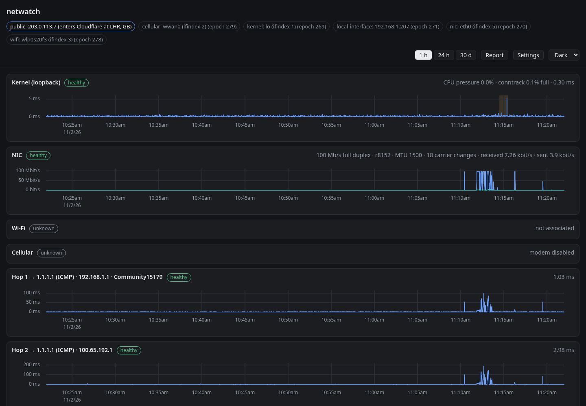

# netwatch

A continuous network monitor in the spirit of `mtr`, as a self-hosted web app. One Rust
daemon watches this host's path to the network layer by layer, follows every change in
that path, and graphs it live and historically:

- **kernel:** loopback round-trip time, drop and error counters, CPU pressure,
  connection tracking, neighbor tables, clock synchronization, config drift, and the
  kernel log
- **NIC:** whichever device carries the egress route right now (failover is followed),
  with its own error and drop counters
- **local interface:** the source address
- **hops 1–3:** toward every target, identified by the routers that answer
- **targets:** ICMP (IPv4 and IPv6), DNS (including the system's own resolver), and
  HTTPS with an expected response

```sh
(cd web && npm ci && npm run build)
NETWATCH_LISTEN=127.0.0.1:8733 cargo run -p netwatch   # then open http://127.0.0.1:8733
```

Port 8733 keeps a development build clear of an installed service on 8732, and is
where `npm run dev` in `web/` proxies to. Targets live in the file named by
`NETWATCH_CONFIG` (the installed service's is `/etc/netwatch/netwatch.toml`), or else
in the built-in `deploy/netwatch.toml`. To install it as a service, from an RPM, with
the install script on other distros, or as a container, see
[deploy/README.md](deploy/README.md).



- **Using it:** [docs/user-manual.md](docs/user-manual.md)
- **What it is and how it's built, in one page:** [docs/overview.md](docs/overview.md),
  with diagrams of the architecture, the data flow, and the database
- **All the documentation:** [docs/README.md](docs/README.md)

## How it is built

The codebase is meant to be a model of domain-driven design and formal methods applied
to a real systems program:

- [docs/adr/](docs/adr/README.md): every design decision, with its context and
  consequences, including the bugs that model checking found before they shipped
  (ADR-0021, ADR-0029)
- [docs/glossary.md](docs/glossary.md): the ubiquitous language that code, specs, and
  UI all use
- [docs/context-map.md](docs/context-map.md): the bounded contexts and how they relate
- [specs/](specs/): Quint specs of the core state machines, checked exhaustively with
  TLC, with the Rust and TypeScript code held to them by trace conformance
- `crates/netwatch-verified`: algorithms proven with Verus (epoch allocation, sequence
  wraparound, counter resets, the rollup merge algebra)
- Kani proofs for every parser of untrusted bytes

`./scripts/check.sh` runs all of it: formatting, lints, tests, conformance, Verus,
Kani, and model checking.
