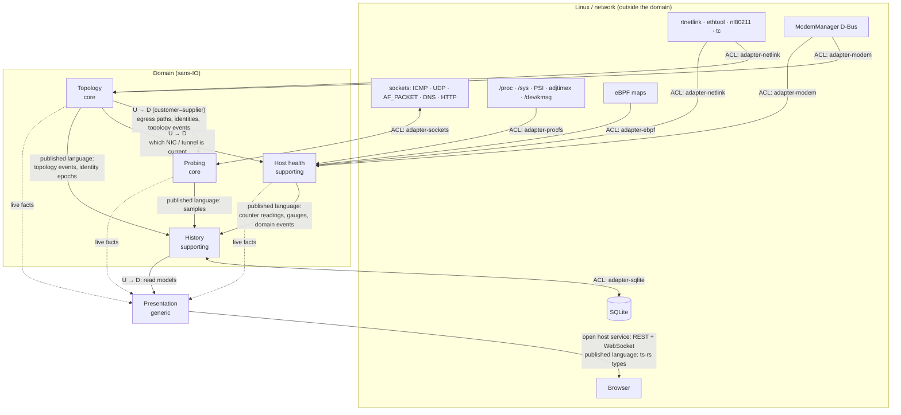

# Context map

The bounded contexts of netwatch and how they relate
([ADR-0013](adr/0013-domain-driven-design.md)). The crate layout follows this map. When
the map changes, the layout changes in the same commit. Terms are defined in
[glossary.md](glossary.md).

## Contexts

| Context | Kind | Owns | Crate |
|---|---|---|---|
| **Topology** | Core | egress paths, roles → identities, identity epochs, topology events | `netwatch-topology` |
| **Probing** | Core | probe streams, cadence, probe lifecycle, reply matching, hop discovery, stream sharing, path traces and the trace schedule | `netwatch-probing` |
| **Host health** | Supporting | telemetry sources, counters, gauges, drop reasons, kernel log lines, suspend gaps, clock health, config drift, public identity, link facts, router names | `netwatch-host-health` |
| **History** | Supporting | samples, tiers, rollups, merge, retention | `netwatch-history` |
| **Presentation** | Generic | rows, status, read models, live stream, backfill | `netwatch-adapter-web` + `web/` |

The **Topology** and **Probing** contexts are where the product's value lies, and where
the formal verification effort goes ([ADR-0016](adr/0016-layered-formal-verification.md)).

Shared by every domain context:
- **Shared crate** (`netwatch-shared`): value objects such as `InterfaceIndex`, `Role`,
  `Identity`, `IdentityEpoch`, and quantities. Every domain context depends on it, so
  changes to it need care.
- **Verified crate** (`netwatch-verified`): Verus-proven algorithms used by several
  contexts:
  - reply matching and sequence-number wraparound (Probing)
  - counter wraparound and resets (Host health)
  - rollup merge algebra (History)
  - identity epoch advancement (Topology)

## Relationships

Notation: **U → D** means upstream → downstream. **ACL** means an anti-corruption
layer, which is an adapter crate that translates OS representations into domain types.

| Upstream → downstream | Pattern | What crosses the boundary |
|---|---|---|
| Topology → Probing | Customer–supplier | Egress paths per target, gateway, roles and identities, topology events (which trigger rebinding and hop discovery) |
| Topology → Host health | Customer–supplier | The current NIC and tunnel, so counters and wireless/cellular gauges are attributed to the right identity |
| Topology, Probing, Host health → History | Published language | Samples, counter readings, gauges, and domain events, all carrying role, identity, and identity epoch |
| History → Presentation | Customer–supplier | Read models: rollups per tier, event markers, statuses |
| Presentation → browser | Open host service + published language | REST and WebSocket. The TypeScript types are generated by `ts-rs` ([ADR-0019](adr/0019-frontend-verification.md)) |
| OS → every domain context | Anti-corruption layer | Adapter crates parse raw data once into domain types ([ADR-0014](adr/0014-type-driven-domain-modeling.md)) |

## As built

Where the implementation sharpened the original map:
- **Probing feeds Topology, too.** A hop's identity is the router that answers, so
  Probing reports it back to Topology as `ProbeIdentified` (ADR-0025). Topology's
  kernel-side protocol (buffering, resync) never touches those roles.
- **The kernel layer has a role.** `Role::Kernel`, bound to `lo`, carries the loopback
  baseline. Host health grades the kernel and NIC layers from counters, and publishes
  per-layer reports (`/api/layers`) instead of samples.
- **Presentation reads behind a flush barrier.** Every API read first flushes the
  History writer, so a backfill never misses a sample that the live stream already
  sent (ADR-0029).
- **Radios are roles off the path** (ADR-0036). The netlink adapter reads nl80211, and
  `netwatch-adapter-modem` reads ModemManager. Host health grades both, and their
  values are gauge readings, which History stores beside samples (ADR-0032).
- **Drop reasons are kernel counters** (ADR-0037). `netwatch-adapter-ebpf` loads
  `netwatch-ebpf` and feeds its counts into the kernel layer's `CounterWatch`, like
  any `/proc` counter.
- **Incidents come from Probing's grading** (ADR-0031, ADR-0034). History stores
  them, and Presentation groups them into episodes for reports (ADR-0033). Grouping
  is presentation, so it stays out of the domain crates.
- **Configuration is the composition root's.** `netwatch::config` parses the TOML file
  into validated targets. No domain crate knows the file exists.

## Notes

- **Wireless and cellular data is split by meaning.** BSSID and serving cell are
  *identities*, so they go to Topology. Signal, bitrate, and retries are *gauges*, so they
  go to Host health. One adapter feeds both contexts.
- **Probing is the only context that sends packets.** Host health's loopback baseline is
  produced by Probing's *loopback probes*, and Host health consumes the resulting samples.
- **History knows nothing about networks.** It stores and aggregates facts keyed by
  role, identity, and identity epoch. Keep it that way.
