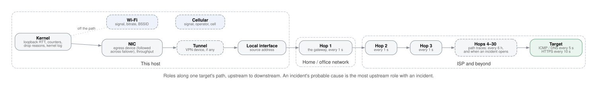
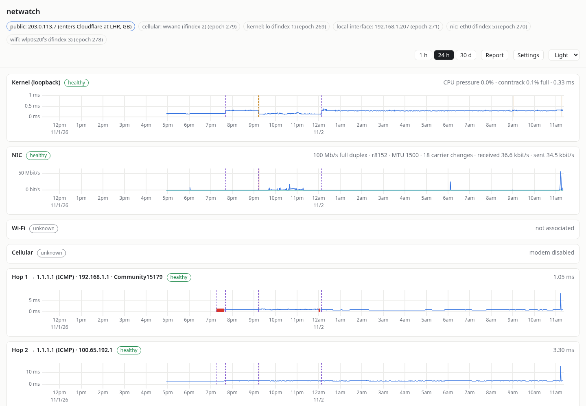
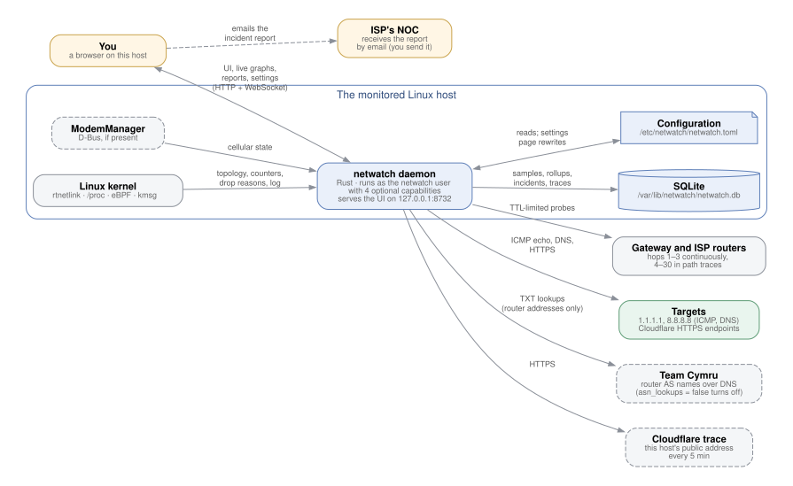
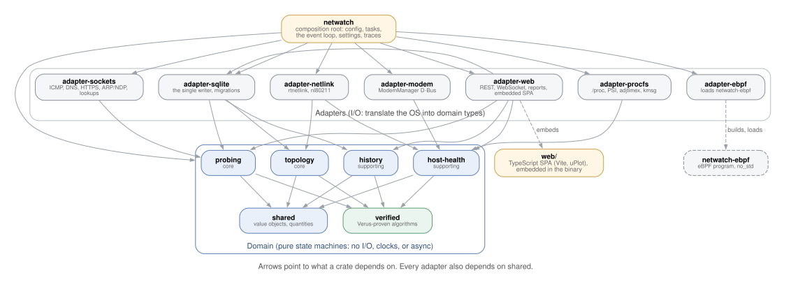
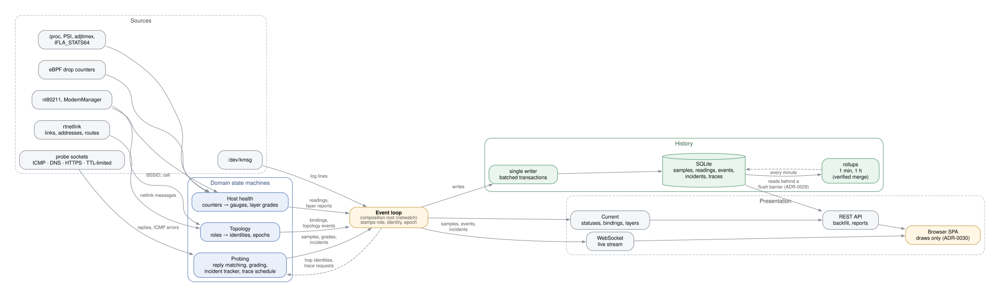
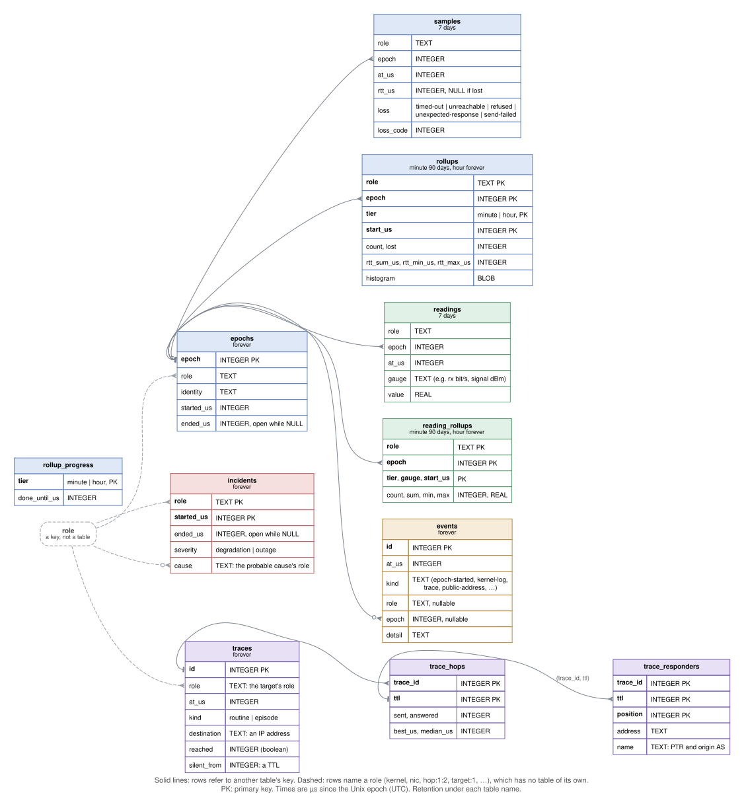
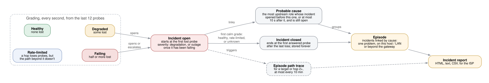

# netwatch: overview

A short tour for anyone evaluating or inheriting the project: what it does, how it is
built, how it is checked, and where it stands. Day-to-day use is in the
[user manual](user-manual.md). Every design decision is recorded, with its reasons, in
[the ADRs](adr/README.md).

## The problem

"The internet is slow" can mean one of several things:
- this computer is overloaded
- its Wi-Fi or cable is flaky
- the home or office router is struggling
- the ISP's network is dropping traffic
- a distant service is down

The usual tools (`ping`, `mtr`, speed tests) show one moment, from one angle. Each
link also changes: laptops switch networks, VPNs come and go, routers reboot. By the
time someone runs a test, the problem has often gone.

ISPs' support desks also ask for evidence: when it happened, for how long, where on
the path, and whether your own equipment was to blame. Most people can't give them
that.

## What netwatch does

netwatch is a monitor that runs all the time on one Linux machine. It measures every
link between that machine and the internet, layer by layer, once a second. It also
follows each link as it changes.

- **It is always on.** It keeps 7 days of every measurement, 90 days of per-minute
  summaries, and per-hour summaries indefinitely.
- **It says where a problem is.** When several things fail at once, it names the
  probable cause: the furthest-upstream failure that started first. It tells apart
  "on this host or LAN" from "beyond the gateway".
- **It isn't fooled by routers that deprioritize probes.** Loss at a router that
  doesn't carry on to the rest of the path is rate limiting, not a fault, and netwatch
  doesn't raise an incident for it.
- **It draws the paths.** A map shows every path to every target, with the routers
  that paths share drawn once, so a failing shared router stands out.
- **It writes the ISP's report.** One click produces a report of any time span, with
  per-router evidence, path traces, router ownership, and link load, in the form a
  network operations center (NOC) asks for. See
  [an example episode](images/report-episode.png).
- **It stays private.** The UI is served only to the local machine. Nothing is sent
  anywhere except the probes themselves and two optional lookups (see the
  [manual](user-manual.md#privacy)).

## How it fits together

One Rust program does everything. It reads the kernel's view of the network (through
rtnetlink, `/proc`, and an optional eBPF program), sends its own probes, stores
results in an embedded SQLite database, and serves a small TypeScript web app built
into the same binary. There is no separate database server, web server, or agent.

### Inside the program

The design follows two rules that keep it testable and easy to change:
- **The domain logic does no I/O** (ADR-0012). It covers following the topology,
  matching replies to probes, grading, incidents, trace scheduling, and the history
  algebra. It lives in pure state machines that take events in and give decisions
  out. Everything that touches the operating system, the network, or the disk lives
  in thin *adapter* crates around it.
- **The daemon decides, the UI displays** (ADR-0030). Every status, interpretation,
  and grouping is computed in Rust and tested there. The browser only draws.

### How data moves

Every measurement is stamped with its *role* (say, "hop 1 toward 1.1.1.1"), the
*identity* behind it at that moment (the router's address), and an *identity epoch*.
The epoch is a counter that advances whenever the identity changes, so measurements
from different routers or devices are never averaged together. One writer task
batches everything into SQLite. Rollups summarize raw samples into minute and hour
tiers.

### What is stored

### How a problem becomes a report

## How it is checked

netwatch's job is to be believed, so wrong numbers are the worst bug it can have.
Correctness is checked in layers (ADR-0016), all of it run by one command,
`./scripts/check.sh`:

| Technique | What it covers |
|---|---|
| **Model checking** (Quint specs, run exhaustively with TLC) | The five core state machines: following topology, probing, live updates with backfill, incidents, and trace scheduling. Every reachable state of a bounded model is checked against invariants. |
| **Trace conformance** | Random runs of each spec are replayed against the real Rust (and TypeScript) code, which must make the same decisions step for step. |
| **Proof** (Verus) | Four algorithms are proven correct for all inputs: identity epoch advancement, sequence-number wraparound in reply matching, counter wraparound and resets, and the rollup merge algebra. |
| **Bounded proof** (Kani) | Every parser of bytes from the network or kernel (13 harnesses) is proven never to panic or read out of bounds. |
| **Tests** | 180+ Rust tests and the frontend's Vitest and fast-check property tests, all test-first and through public interfaces (ADR-0017). Network-namespace integration tests run with root. |
| **Static checks** | `rustfmt`, `clippy -D warnings`, strict TypeScript (no `any`, no unchecked casts), and ESLint. |

Model checking has caught real design bugs before they shipped. The ADRs record two
of them (ADR-0021, ADR-0029).

## Deployment

netwatch runs as a systemd service under its own unprivileged user. It holds at most
four Linux capabilities, each optional: without one, the matching feature is
disabled and reported, never fatal (ADR-0007). There are three ways to install
([deploy/README.md](../deploy/README.md), ADR-0041):

| Method | For |
|---|---|
| RPM (`packaging/build-rpm.sh`) | Fedora, RHEL, and relatives |
| Install script (`packaging/install.sh`) | Any other systemd distro: Debian, Ubuntu, Arch, … |
| Container image (`packaging/build-container.sh`) | podman or docker, run with host networking |

## Size and status

- About 17,000 lines of Rust in 16 crates and 2,600 lines of TypeScript.
- 42 architecture decision records, a glossary, and a context map.
- Working end to end and in daily use. The current feature list is the *Status*
  section of [CLAUDE.md](../CLAUDE.md).

**Deliberately out of scope** (ADR-0010): alerting, Prometheus export, remote access,
monitoring several hosts, and firewall monitoring. netwatch is a single-host
diagnostic tool, not a monitoring platform.

**Not built yet**, with the reasons in the ADRs:
- persisting HTTPS phase timings
- IPv6 egress for the host-wide roles
- path traces of HTTPS targets
- large-packet (MTU) probes
- TCP retransmissions in the report
- modem line statistics

**Open item:** no license has been chosen yet. The RPM says
`LicenseRef-Not-Yet-Chosen`. Pick one before distributing the code outside the
organization.

## Where to read next

| If you want to… | Read |
|---|---|
| use it | [user-manual.md](user-manual.md) |
| install it | [deploy/README.md](../deploy/README.md) |
| understand a design choice | [adr/README.md](adr/README.md) |
| learn the vocabulary | [glossary.md](glossary.md) |
| see the module boundaries | [context-map.md](context-map.md) |
| change the code | [CLAUDE.md](../CLAUDE.md), the working rules |
