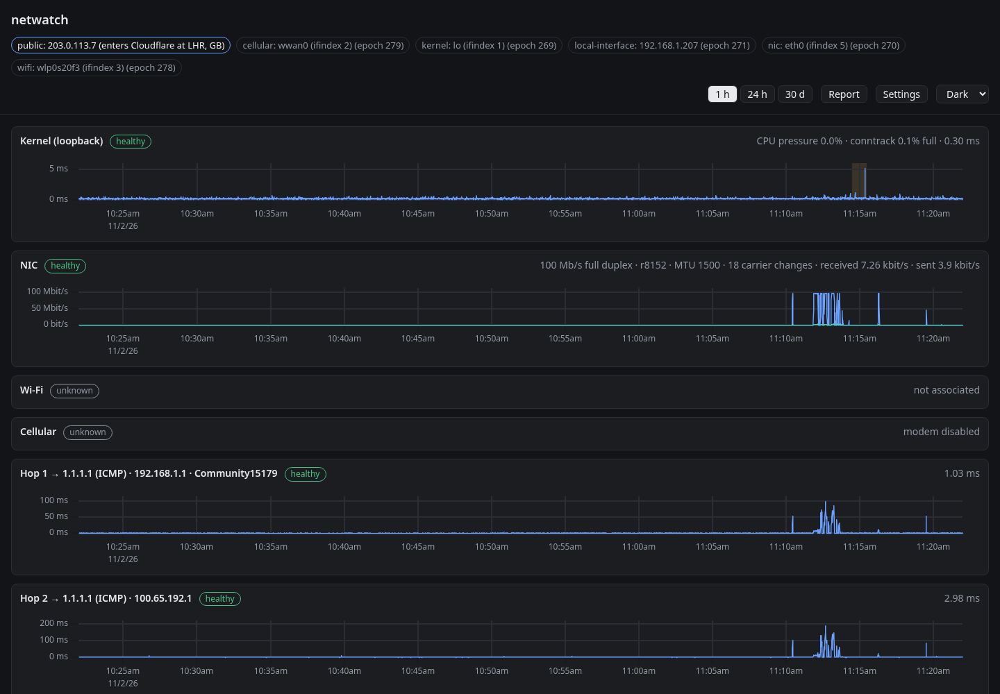
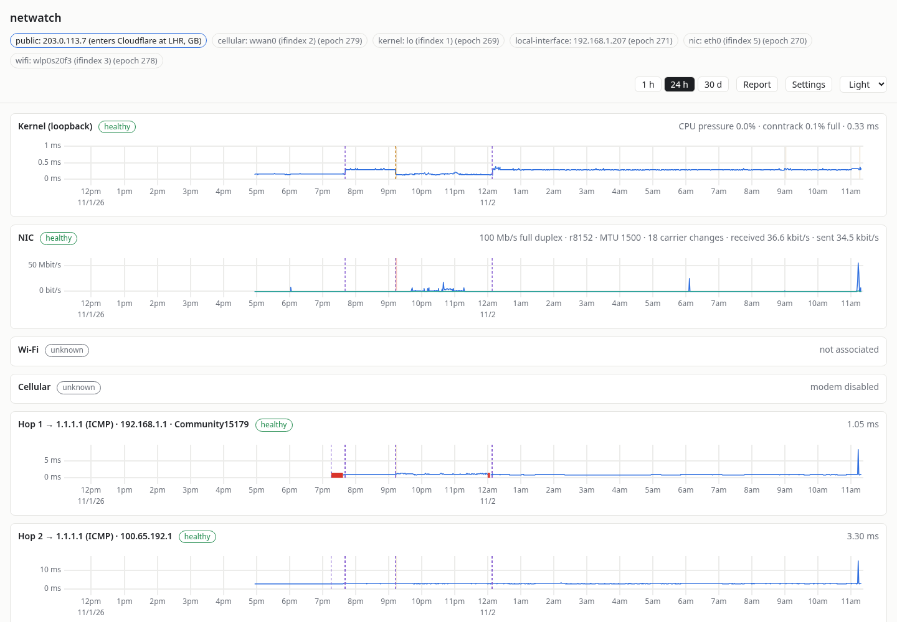
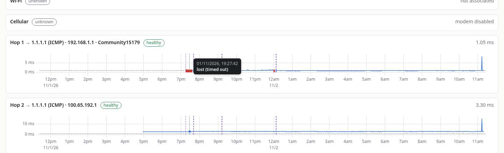
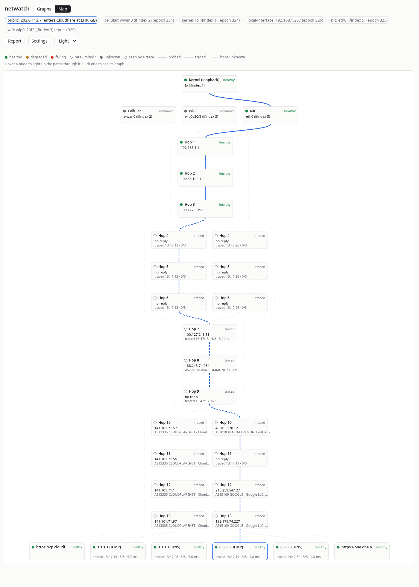
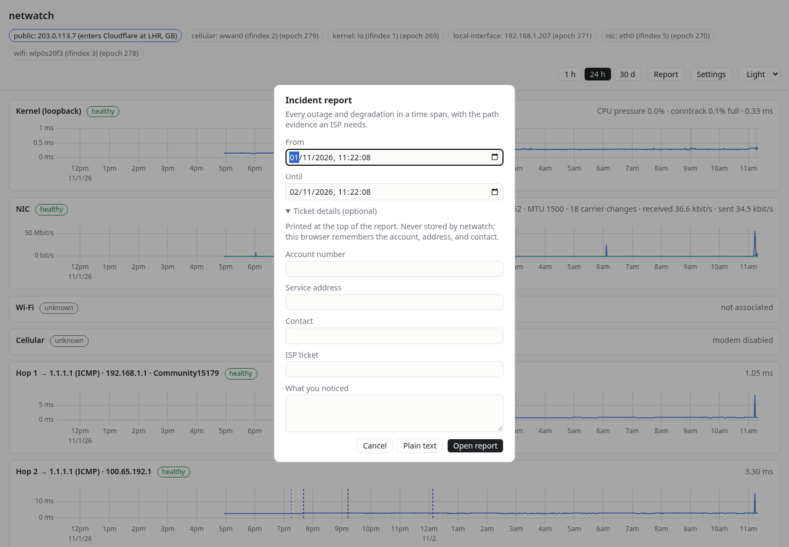
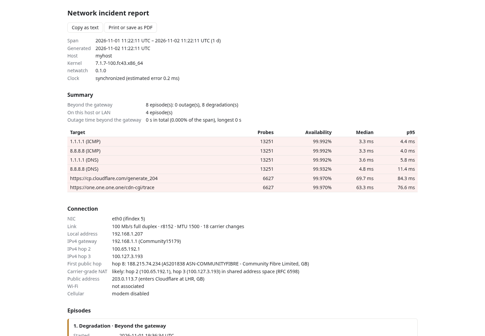
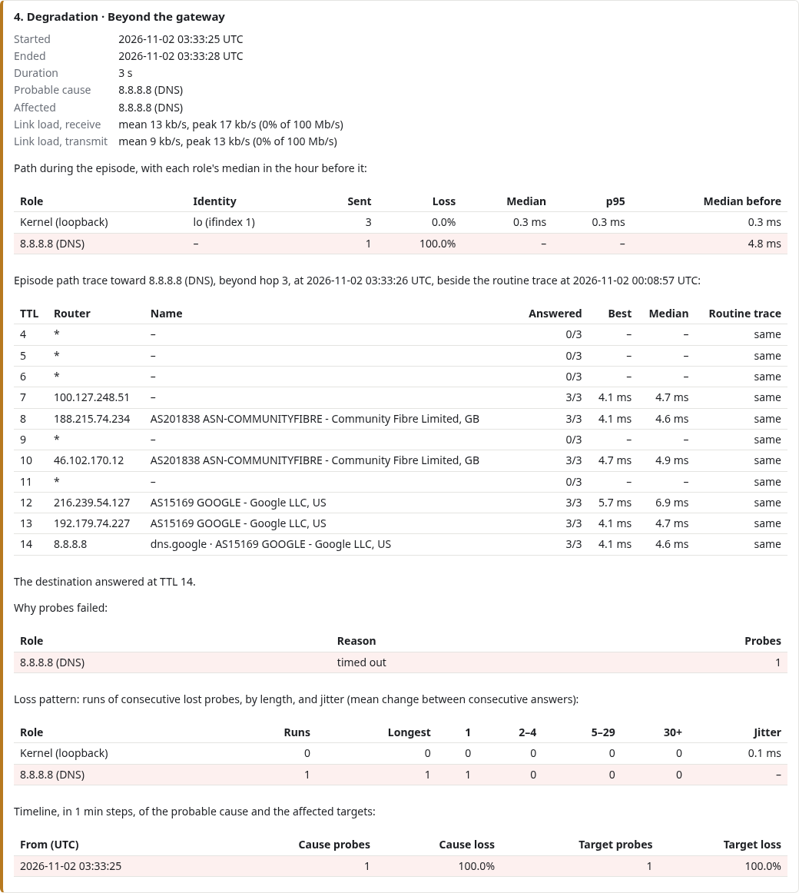
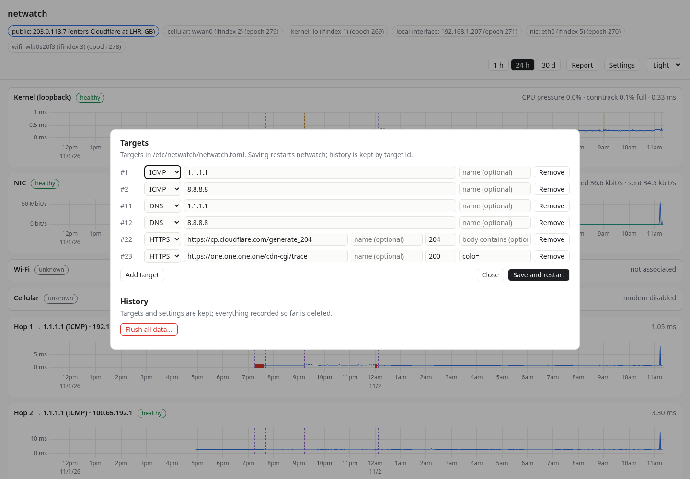

# netwatch user manual

netwatch watches this computer's connection to the internet all the time. It tells you
whether a problem is on your own machine, your home or office network, or your
internet provider's (ISP's) network. When the problem is the ISP's, it writes a
report you can send them.

This manual covers day-to-day use. For installing, see
[deploy/README.md](../deploy/README.md). For how it works inside, see
[overview.md](overview.md).

- [Opening netwatch](#opening-netwatch)
- [The main screen](#the-main-screen)
- [Reading the graphs](#reading-the-graphs)
- [Statuses](#statuses)
- [Incidents and markers](#incidents-and-markers)
- [The network map](#the-network-map)
- [Reporting a problem to your ISP](#reporting-a-problem-to-your-isp)
- [Changing what netwatch watches](#changing-what-netwatch-watches)
- [Starting over](#starting-over)
- [Privacy](#privacy)
- [Troubleshooting](#troubleshooting)

## Opening netwatch

Open <http://127.0.0.1:8732> in a browser on the machine netwatch runs on. The page
is only served to that machine, never to the network. To view it from elsewhere, use
an SSH tunnel: `ssh -L 8732:127.0.0.1:8732 that-host`, then open the same address
locally.

netwatch runs as a background service and keeps measuring whether or not the page is
open. Graphs update live while it is.

## The main screen

**The header** shows your public address and where it enters Cloudflare's network,
and one chip per thing netwatch is following right now: the network card (NIC), the
local address, Wi-Fi, cellular, and so on. When one of these changes (you switch from
Wi-Fi to cable, say), the chip changes and the graphs mark the moment.

**The controls** on the right:

| Control | What it does |
|---|---|
| Graphs · Map | The rows of graphs, or the [network map](#the-network-map). |
| 1 h · 24 h · 30 d | The time range every graph shows. |
| Reset zoom | Appears after you zoom; returns to the selected range. |
| Report | Writes an incident report for your ISP ([below](#reporting-a-problem-to-your-isp)). |
| Settings | Changes the targets, and can delete all history. |
| Auto · Light · Dark | The color theme. Auto follows your system. This browser remembers it. |

**The rows** run top to bottom in the order your traffic travels, the way `mtr` or
`traceroute` lists a path:

| Row | What it measures |
|---|---|
| Kernel (loopback) | How quickly this machine answers itself, plus CPU pressure and connection-tracking load. If this row is slow, the machine itself is struggling. |
| NIC | The network card carrying traffic now: link speed, errors, carrier drops, and how much traffic is flowing. |
| Wi-Fi, Cellular | Signal and connection details, when these radios exist. They are shown even if they're not carrying traffic. |
| Hop 1 | Your router (the gateway). Its title shows its address and name. |
| Hop 2, Hop 3 | The first routers beyond it, usually your ISP's. |
| Targets | Well-known services on the internet (by default Cloudflare's and Google's): ping, DNS, and HTTPS. |

Each row's title names the role, its current identity (an address or device), and
its status. Its current values are on the right.

## Reading the graphs

- **The line** is the round-trip time (RTT) in milliseconds: how long a probe took to
  come back. Lower and flatter is better. Rows with no RTT, such as the NIC, show
  their own units, such as traffic in bit/s.
- **Every row shares one time axis.** Drag across any graph to zoom every row to that
  stretch. *Reset zoom* undoes it.
- **Hover** over a graph for the exact time and value, and for any incident or event
  there.

Over 24 h and 30 d, each point summarizes a minute or an hour, so a single lost probe
shows up as loss in that minute rather than as a gap.

## Statuses

The badge next to each row's title says how it is doing now, judged by the daemon
from its last 12 probes:

| Status | Meaning |
|---|---|
| healthy | Every recent probe was answered. |
| degraded | Some recent probes were lost. |
| failing | Half or more were lost. |
| rate-limited | A router lost probes, but everything beyond it on the path is fine. Routers often give low priority to answering probes about themselves. That is not a fault, and netwatch doesn't raise an incident for it. |
| unknown | Nothing recent to judge by (just started, or the radio is off). |
| disabled | A source netwatch can't use on this machine. The row says why. |

## Incidents and markers

**Incident bands** are shaded stretches behind a graph: amber for a degradation, red
for an outage. A band appears only on the row it happened to. Hover over it for
its duration and probable cause.

**Event markers** are dashed vertical lines for things that happened at a moment:
- the NIC, address, or router changed
- netwatch started, after a gap in the graphs. Things that are the same as before it
  stopped aren't marked again.
- a kernel log line about networking
- the clock jumped
- a network setting changed
- the public address changed
- a path trace ran

Each marker appears only on the rows it concerns. Hover over one to read it.

netwatch also decides a **probable cause** for each incident: the incident furthest
upstream on the path that started first. If your router drops out, every target
after it fails too. netwatch reports that as one problem caused by hop 1, not as six
separate failures.

## The network map

The **Map** tab draws every path from this machine to every target as one picture,
top to bottom in the order traffic travels. The page address `…/#map` opens it
directly.

- **Each box is one thing on a path:**
  - this machine's layers: kernel, NIC, local interface
  - a router
  - a target

  The dot and the word in its corner give its status, as in the
  [Statuses](#statuses) table.
- **Shared routers are drawn once.** When several targets' paths go through the
  same router at the same distance, they meet at that box. If several targets fail
  at once and all their paths share a red box, that router is the likely place to
  look.
- **A shared router lists each path's own status.** Hover over it to see them. A
  router can be rate-limited on one path and fine on another.
- **Boxes with a dashed outline and "traced"** are routers beyond hop 3, which
  netwatch doesn't measure continuously. They come from the latest path trace,
  which runs every 6 hours and whenever a problem starts beyond your router. Hover
  for when it ran, how many probes were answered, and the median time.
- **"no reply"** marks a distance at which the trace got no answer.
- **Targets are at the bottom**, or at the distance a trace found them.
- **Lines:**

  | Line | Meaning |
  |---|---|
  | Solid | Both ends are measured all the time. |
  | Dashed | Known from a trace. |
  | Dotted | The hops in between are unknown. For example, HTTPS targets aren't traced, and a target's trace may not have run yet. |

- **Hover over a box** to light up the paths through it. **Click a box** with a status
  to jump to its graph.
- **Several boxes at one distance** usually mean load balancing: the ISP spreads
  traffic over several routers. The map joins each of them to each box at the next
  distance, because a trace can't tell which leads where.

The map shows the network as it is now. For what happened earlier, use the graphs or
a report.

## Reporting a problem to your ISP

Click **Report**, pick the time span, and click **Open report**.

**Ticket details** (optional) prints your account number, service address, contact,
ticket number, and a description at the top of the report. netwatch never stores
them. Your browser remembers the account, address, and contact for next time.

The report opens in a new tab:

It is written for an ISP's network operations center (NOC):
- **Summary:** how many episodes there were, where each began (your side or theirs),
  and the availability of each target.
- **Connection:** your link, your addresses, the routers on your path and who owns
  them, the first public router (where the ISP's network starts), and whether the
  ISP uses carrier-grade NAT.
- **Episodes:** one per problem. Each has its start, end, and probable cause, every
  router's loss and latency during it compared with the hour before, the pattern of
  loss, how busy your own link was (so the ISP can rule out "you were saturating your
  line"), and a full path trace taken when it began, beside a normal one.

- **By hour:** loss and latency for every hour, and every event.
- **Method:** how netwatch measured, so the NOC can trust the numbers.

To send it, use **Copy as text** and paste the text into an email, or **Print or
save as PDF** and attach the PDF. *Plain text* in the dialog opens the text version
directly. A CSV of the raw figures is at `/report.csv` with the same parameters.

Episodes "on this host or LAN" point at your own equipment. Check those before
calling the ISP.

## Changing what netwatch watches

Click **Settings**.

Each target is one line: a kind, an address, and an optional name. Kinds:
- **ICMP**: ping an address.
- **DNS**: ask a DNS server for the root zone. `system` means your machine's own
  resolver.
- **HTTPS**: fetch a URL, expecting a status code and optionally some text in the
  body.

ICMP and DNS targets also get hop 1–3 rows and path traces. Hops are always measured
with pings, so a DNS target's hop rows show the route pings to that server take. That
is nearly always the route its DNS queries take too. Targets toward the same address
share their hop measurements, so a DNS target with the same address as an ICMP
target adds no extra traffic.

**Save and restart** rewrites `/etc/netwatch/netwatch.toml` and restarts netwatch in
a second or two. History is kept per target number, so a target you edit keeps its
graph. A removed target's number is never reused.

The file can also be edited by hand. Restart the service afterward
(`sudo systemctl restart netwatch`).

## Starting over

**Settings → Flush all data…** deletes all history, incidents, and traces after you
confirm. Targets and settings stay. Every open browser tab starts over empty. This
can't be undone.

## Privacy

netwatch sends nothing about you anywhere, with these exceptions:
- **Probes:** it sends pings, DNS queries, and HTTPS requests to the targets you
  configure.
- **Public address:** it asks Cloudflare for your public address every 5 minutes.
- **Router names:** it looks up router names in DNS. The AS (network owner) lookups
  go to Team Cymru and contain only router addresses, never yours. Set
  `asn_lookups = false` in the configuration to turn them off.

The web page is served only to this machine. Everything is stored in
`/var/lib/netwatch/netwatch.db`. Raw measurements are kept 7 days, minute summaries
90 days, and hourly summaries, incidents, and traces indefinitely.

## Troubleshooting

| What you see | Why, and what to do |
|---|---|
| The page doesn't load | Check the service with `systemctl status netwatch`, and its logs with `journalctl -u netwatch`. |
| "ICMP probes: permission denied" | The machine doesn't allow unprivileged ping. See *Requirements on the host* in [deploy/README.md](../deploy/README.md). |
| Hop 1 is always *unknown* or *rate-limited* | Another netwatch (or mtr) on the same machine is probing the same router, which answers only about once a second. Run one at a time. |
| A source is *disabled* | netwatch lacks a permission it needs, for example the kernel log or drop reasons in a container. Everything else still works. The row says which. |
| Router names are missing | No upstream DNS resolver was found, or the routers have no names. |
| Settings say the file isn't writable | The configuration isn't writable by the netwatch user. The RPM and the install script set this up; a hand-made file needs `root:netwatch` ownership and mode `0664` on the file and `0775` on its directory. |
